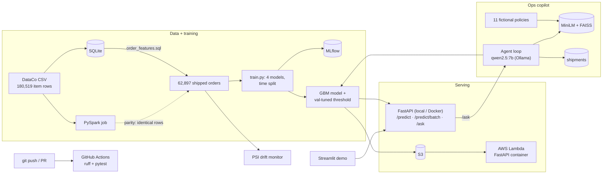

# ShipSense — late-delivery risk + logistics operations copilot

[](https://github.com/AmeyaAstro/shipsense/actions/workflows/ci.yml)

Predict, **at the moment an order is placed**, whether it will arrive late; serve that model as a tested,
containerised API on AWS; monitor it for drift; and answer operations questions with an LLM copilot that
combines the model, a shipment database and (fictional) company policies, with citations.

Built end to end on the public [DataCo supply-chain dataset](https://www.kaggle.com/datasets/shashwatwork/dataco-smart-supply-chain-for-big-data-analysis)
(180,519 item rows → 62,897 shipped orders). Every number below was measured in this repo; the reports
and walkthroughs show how.

| | |
|---|---|
| **Model** | HistGradientBoosting, test ROC-AUC **0.782** on a time-based split, no leaky features |
| **Serving** | FastAPI + Pydantic, Docker, **AWS Lambda** (container, arm64) with the model in S3 |
| **MLOps** | MLflow tracking, GitHub Actions CI (ruff + **61 offline tests**), PSI drift monitoring |
| **Data eng.** | features in SQL, re-implemented in **PySpark** with exact parity on all 62,897 orders |
| **LLM** | RAG (MiniLM + FAISS) + tool-calling agent on a local `qwen2.5:7b`, 25-question eval |
| **Demo** | Streamlit UI: risk form, ask-the-copilot, drift summary |

<!-- Screenshots: add after recording the demo (see docs/demo_video_script.md)


-->

## Architecture



## Results

**Model** (test set: Jul 2017 – Jan 2018, 13,071 orders, 57% late):

| Model | ROC-AUC | PR-AUC | Balanced acc. | Accuracy | Brier ↓ | Train time* |
|---|---|---|---|---|---|---|
| Shipping-mode rule (no ML) | 0.746 | 0.788 | 0.724 | 0.696 | 0.188 | 0 s |
| Logistic regression | 0.756 | 0.844 | 0.735 | 0.711 | 0.187 | 0.3 s |
| **Gradient boosting** | **0.782** | **0.862** | **0.750** | **0.726** | **0.175** | 2.4 s |
| PyTorch MLP (entity embeddings) | 0.780 | 0.860 | 0.749 | 0.725 | 0.176 | 9.4 s |

\*Apple M4, latest run; timings vary run to run, metrics do not.

**Honest read:**
- Gradient boosting and the PyTorch network are tied, and both beat the no-ML rule by ~3.5 AUC points.
- The deep model trains ~4x slower, so **gradient boosting is the production choice**.
- Why not 99%? Within a shipping mode, actual shipping days are spread almost evenly, so most remaining
  lateness isn't predictable at order time. Projects reporting ~98% use `Days for shipping (real)` or
  `Delivery Status`, which *are* the label.

**Serving:**

| Where | Warm `/predict` | 1,000-order batch | Cold start |
|---|---|---|---|
| Docker on an Apple M4 (localhost) | median 8.2 ms, p95 14.3 ms | 29 ms | n/a |
| AWS Lambda, 2 GB arm64 (from a laptop over the internet) | median 65 ms, p95 73 ms | 350 ms† | 7.7 s |

†Measured at 1 GB. At 1 GB the cold start hit Lambda's 10 s init limit (first request ~26 s), which is why
the function runs at 2 GB: Lambda gives CPU in proportion to memory. See [`docs/aws_deploy.md`](docs/aws_deploy.md).

**Ops copilot** (25 questions, [`reports/rag_eval.md`](reports/rag_eval.md)):
- Retrieval hit@4 **100%** (hit@1 82%).
- Answers correct **24/25** with deterministic tool prefetch vs 23/25 when the model decides alone.
- 1 vs 3 answers contained an invented citation.
- The one fix between eval runs was found with the same questions, so 24/25 is optimistic.

**Drift** ([`reports/drift/summary.md`](reports/drift/summary.md)):
- Real months drift hugely on market and basket features (feature PSI 4.5–12: markets rotate in monthly
  blocks, and orders become single-item from Oct 2017).
- Yet monthly AUC stays **0.754–0.792**, because lateness is driven by shipping mode, whose mix barely
  moves (PSI ≤ 0.006).
- So alerts use prediction drift + AUC drop, with feature PSI as the diagnosis: 12 months stable,
  Oct 2017 "watch", and a synthetic First Class surge → "act".

## Key design decisions

1. **Order-level, not item-level.** All items in an order share the label; item-level random splits leak
   orders across train and test.
2. **No leakage.** Only order-time fields; post-delivery fields are excluded and a test enforces it.
3. **Time-based split** (train 2015–16, validate H1 2017, test H2 2017+) and a **threshold tuned on
   validation only**.
4. **One feature function for training and serving**, plus a test that the API's score equals the
   pipeline's (no train/serve skew).
5. **Two feature engines, one answer:** PySpark reproduces the SQL table exactly; CI keeps them in sync.
6. **Model in S3, not baked into the Lambda image:** a new model is an upload, old models stay for
   rollback. The image is the same FastAPI app, run unchanged via the Lambda Web Adapter.
7. **Copilot guardrails from observed failures:**
   - What happened: the 7B model skipped tools and invented a policy and citations.
   - Fix: tools are prefetched deterministically, and citations are checked against what was retrieved.
8. **Alert on what changes decisions:** alerting on any drifting feature fired every month while the
   model was fine (alert fatigue).
9. **Everything testable offline:** the LLM and embedder are injected, so CI needs no LLM, model download,
   dataset or AWS.

## Project layout

```
sql/order_features.sql          feature engineering in SQL
spark/order_features_spark.py   same features in PySpark + row-by-row comparison with SQL
src/shipsense/
  config.py data.py             paths, splits; CSV -> SQLite -> order-level features
  baselines.py torch_model.py   rule, logistic, gradient boosting; PyTorch embeddings MLP
  evaluate.py train.py          metrics + threshold; trains all models, logs to MLflow (tracking.py)
  api.py                        FastAPI: /health /predict /predict/batch /ask (model from disk or S3)
  rag.py llm.py tools.py        retrieval; provider-agnostic LLM client; the agent's three tools
  agent.py shipments.py         tool-calling loop with guardrails; order outcome table for lookups
  drift.py                      PSI drift reports + monthly summary
app/streamlit_app.py            demo UI (thin client over the API)
knowledge/                      11 fictional shipping-policy docs
eval/                           25-question copilot eval set + scorer
deploy/aws/                     Lambda Dockerfile, deploy.sh, teardown.sh
tests/                          61 pytest tests, all offline
reports/                        model metrics, copilot eval, drift reports
docs/                           weekly walkthroughs, AWS guide, resume bullets, demo script
```

## Run it

Needs Python 3.10+ (3.11 recommended); Java 17+ for Spark; Ollama for the copilot; Docker for containers.

```bash
# put DataCoSupplyChainDataset.csv in archive/ or data/raw/  (Kaggle download)
make setup && make all        # venv -> features -> train 4 models -> 61 tests
make serve                    # API at http://127.0.0.1:8000/docs
make demo                     # Streamlit UI at http://localhost:8501 (with `make serve` running)
make mlflow-ui                # compare training runs
make drift ARGS=--summary     # monthly drift table -> reports/drift/summary.md
make spark-features ARGS=--compare            # PySpark features, checked against SQL
make copilot-data && ollama pull qwen2.5:7b   # copilot data + local LLM; then ask via /ask or the UI
make rag-eval                                 # ~20 min copilot evaluation
make docker-build && make docker-run          # API in a container
deploy/aws/deploy.sh / deploy/aws/teardown.sh # AWS Lambda (read docs/aws_deploy.md first: costs)
```

## Docs

- Walkthroughs (design choices, how to run, interview questions):
  [Week 1](docs/week1_walkthrough.md) · [Week 2](docs/week2_walkthrough.md) ·
  [Week 3](docs/week3_walkthrough.md) · [Week 4](docs/week4_walkthrough.md)
- [AWS deployment guide](docs/aws_deploy.md) · [Copilot eval](reports/rag_eval.md) ·
  [Drift summary](reports/drift/summary.md)

Data: DataCo Smart Supply Chain (Kaggle), not redistributed here. The policies in `knowledge/` are fictional.
