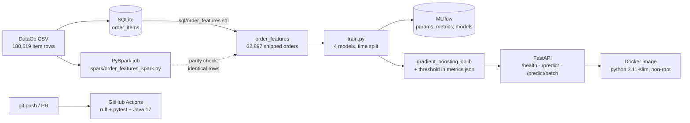

# ShipSense — late-delivery risk + logistics operations copilot

[](https://github.com/AmeyaAstro/shipsense/actions/workflows/ci.yml)

Predict, **at the moment an order is placed**, whether it will arrive late, serve that model as a
tested, containerised API, and (in later milestones) wrap it in an LLM agent that answers operations
questions using the model plus company shipping policies.

> Status: **Week 2 of 4 complete** — Week 1 built the leakage-safe data pipeline and models;
> Week 2 added MLflow tracking, a FastAPI service, Docker, GitHub Actions CI and a PySpark
> feature job verified against the SQL.

## Architecture



## Results (test set: Jul 2017 – Jan 2018, 13,071 orders, 57% late)

| Model | ROC-AUC | PR-AUC | Balanced acc. | Accuracy | Brier ↓ | Train time* |
|---|---|---|---|---|---|---|
| Shipping-mode rule (no ML) | 0.746 | 0.788 | 0.724 | 0.696 | 0.188 | 0 s |
| Logistic regression | 0.756 | 0.844 | 0.735 | 0.711 | 0.187 | 0.3 s |
| **Gradient boosting** | **0.782** | **0.862** | **0.750** | **0.726** | **0.175** | 2.4 s |
| PyTorch MLP (entity embeddings) | 0.780 | 0.860 | 0.749 | 0.725 | 0.176 | 9.4 s |

\*Apple M4, latest run (`reports/model_comparison.md`); timings vary run to run, metrics do not.

**Honest read:** gradient boosting and the PyTorch network are tied (within 0.003 AUC), and both
beat the no-ML rule by ~3.5 AUC points. The deep model gives no accuracy gain on this small tabular
problem and trains ~4x slower, so **gradient boosting is the production choice**; the PyTorch model
stays as the benchmark and as the base for adding text/sequence inputs later.

Why not 99%? The EDA shows actual shipping days are spread almost evenly within each shipping mode,
so most of the remaining lateness is not predictable from order-time data. Versions of this project
that report ~98% accuracy are using `Days for shipping (real)` or `Delivery Status`, which **are** the
label (see `notebooks/01_eda.ipynb`).

**Serving** (Docker container on an Apple M4, localhost): `/predict` median 8.2 ms, p95 14.3 ms over
500 sequential requests; `/predict/batch` scores 1,000 orders in a median 29 ms.

## Key design decisions

1. **Order-level, not item-level.** The CSV has 180k item rows but only 65k orders, and all items in
   an order share the label. Item-level random splits put the same order in train and test.
2. **No leakage.** Only fields known at order time. Real shipping days, delivery status, shipping date,
   order status and profit fields are excluded (a unit test enforces this).
3. **Canceled / suspected-fraud orders removed:** they never ship, so they are always labelled "not late".
4. **Time-based split:** train 2015–2016, validate Jan–Jun 2017, test Jul 2017–Jan 2018.
5. **Threshold tuned on validation only** (Youden's J), then applied unchanged to test and in the API.
6. **One feature function for training and serving** (`add_calendar_features`) to prevent train/serve
   skew; a test checks the API's score equals the pipeline's.
7. **Two feature engines, one answer:** the PySpark job reproduces the SQL table exactly on all
   62,897 orders, and a CI test keeps them in sync.

## Project layout

```
sql/order_features.sql          feature engineering in SQL (SQLite now, Postgres-compatible)
spark/order_features_spark.py   same features in PySpark + row-by-row comparison with SQL
src/shipsense/config.py         paths, split dates, feature lists
src/shipsense/data.py           CSV -> SQLite -> order-level features, time split
src/shipsense/baselines.py      shipping-mode rule, logistic regression, gradient boosting
src/shipsense/torch_model.py    PyTorch embeddings + MLP with early stopping
src/shipsense/evaluate.py       shared metrics + threshold selection
src/shipsense/train.py          trains everything, writes reports/, logs to MLflow
src/shipsense/tracking.py       MLflow setup and per-model logging
src/shipsense/api.py            FastAPI service with Pydantic validation
tests/                          25 pytest tests on synthetic data (pipeline, API, Spark parity)
Dockerfile, docker-compose.yml  API container (requirements-serve.txt = runtime deps only)
.github/workflows/ci.yml        lint + tests on every push / PR
reports/                        metrics.json, model_comparison.md
docs/                           weekly walkthroughs
```

## Run it

Needs Python 3.10+ (3.11 recommended), and for the Spark job Java 17+.

```bash
# put DataCoSupplyChainDataset.csv in archive/ or data/raw/  (Kaggle download)
make setup            # venv + dependencies
make all              # build features (SQL) -> train 4 models -> run tests
make mlflow-ui        # compare training runs at http://127.0.0.1:5000
make serve            # API at http://127.0.0.1:8000/docs
make docker-build && make docker-run         # same API in a container
make spark-features ARGS=--compare           # PySpark features, checked against SQL
```

Example request:

```bash
curl -X POST http://127.0.0.1:8000/predict -H "Content-Type: application/json" -d '{
  "order_ts": "2017-09-14T10:30:00", "shipping_mode": "Standard Class", "payment_type": "DEBIT",
  "market": "LATAM", "order_region": "Central America", "order_country": "México",
  "customer_segment": "Consumer", "main_department": "Fan Shop", "n_items": 2,
  "total_quantity": 3, "total_sales": 420.5, "avg_discount_rate": 0.1, "n_departments": 1}'
# {"late_probability":0.4078,"is_late_risk":false,"threshold":0.595,"model_version":"gradient_boosting-…"}
```

## Roadmap

- [x] **Week 1** — EDA, SQL features, baselines, PyTorch model, honest comparison
- [x] **Week 2** — MLflow tracking, FastAPI service, Docker, GitHub Actions CI, PySpark feature job
- [ ] **Week 3** — RAG over shipping SOPs + LLM agent with tools (`predict_risk`, `lookup_shipment`, `search_policy`), eval set
- [ ] **Week 4** — AWS deployment, drift monitoring, demo video

Data: [DataCo Smart Supply Chain for Big Data Analysis](https://www.kaggle.com/datasets/shashwatwork/dataco-smart-supply-chain-for-big-data-analysis) (Kaggle). Not redistributed in this repo.
