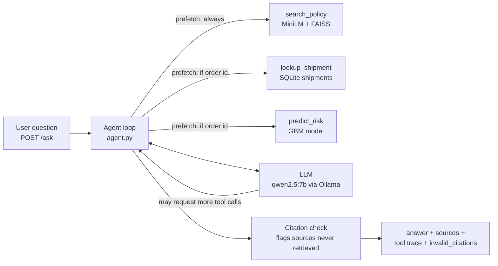

# Week 3 walkthrough — RAG + a tool-calling ops copilot

Budget about 2 hours. Open each file as you read it, and run the commands yourself.

## 1. The big picture
Week 2 gave other systems a risk score. Week 3 lets a **person** ask questions in plain English:
- "How much credit does a customer get if the order is 2 days late?" → answered from **policy documents**.
- "What happened to order 62489?" → answered from the **database**.
- "Is order 62477 high risk, and what should we do?" → answered from the **model** plus **policy**.

Three ideas make this work:

| Idea | One-line meaning | File |
|---|---|---|
| **RAG** (retrieval-augmented generation) | Find the relevant passage first, then let the LLM answer *from it*, with a citation | `rag.py` |
| **Tool calling** | The LLM asks *our code* to run a function (search, DB lookup, model) and reads the JSON result | `tools.py`, `llm.py` |
| **Agent loop** | Repeat "LLM → tools → LLM" until it answers in plain text | `agent.py` |



## 2. The knowledge base — `knowledge/*.md`
- 11 short policies for a **fictional** "ShipSense Logistics". Every file carries a FICTIONAL banner.
- Real company policies are private. Fictional ones let us control the facts, so answers can be scored.
- The shipping modes, scheduled days, markets and segments match the DataCo data, so the policies and
  the model talk about the same world.
- The facts are specific on purpose (e.g. "25%", "2 business hours", "$120"): a vague policy can't be
  scored objectively.

## 3. Retrieval — `rag.py`
1. **Chunking (`chunk_markdown`):** one chunk per `##` section. A section longer than 150 words becomes
   overlapping windows of 150 words, overlapping by 30 so a sentence cut at the edge still appears whole
   in one window. The FICTIONAL banner is skipped: it's on every file, so it would only add noise.
   Result: 46 chunks from 11 docs.
2. **Embedding:** `all-MiniLM-L6-v2` turns text into 384 numbers that capture meaning. We embed
   "title. section. text", so a chunk saying "25% of the shipping charge" still carries "Refund and
   Delivery Credit Policy". Vectors are **normalised** (length 1).
3. **Index:** FAISS `IndexFlatIP` = exact inner-product search. For normalised vectors, the inner
   product equals the **cosine similarity**. "Flat" means it compares against every vector, which is
   perfectly fast for 46 chunks; approximate indexes (IVF, HNSW) only matter at millions of vectors.
4. **Citations:** each hit knows its `doc § section`, e.g. `03_refund_and_credit_policy.md § Credit amounts`.
5. **Swappable embedder:** real runs use MiniLM, while tests use `HashingEmbedder` (word counts hashed
   into 256 buckets with `crc32`). CI therefore downloads no model, and the tests check *our* logic.

**A real bug worth telling in interviews.** The first index build crashed with a *segmentation fault*.
- Cause: PyTorch and FAISS each ship their own copy of the OpenMP threading library (`libomp`). On
  macOS, if FAISS's copy loads first, PyTorch crashes when it encodes text.
- How I found it: I isolated it by testing each import order separately.
- Fix: import `torch` before `faiss`.
- Twist: ruff's import sorter then "helpfully" re-sorted the imports alphabetically and undid the fix,
  so the two lines are fenced with `# isort: off` / `# isort: on`.
- Lessons: auto-fixers can change behaviour, and native-library conflicts show up as segfaults, not
  Python errors.

## 4. The LLM client — `llm.py`
- One method for every provider: `chat(messages, tools) -> LLMResponse(content, tool_calls)`.
- One internal message format (OpenAI/Ollama style):
  - `user` and `assistant` messages
  - an assistant message carrying `tool_calls`
  - `tool` messages carrying results.
- **`OllamaLLM` (default):** `qwen2.5:7b` running on your Mac, so it's free and private. It uses
  `temperature=0` and a fixed seed, so runs are repeatable. Verified live.
- **`AnthropicLLM` (optional):** used only if `SHIPSENSE_LLM_PROVIDER=anthropic` and `ANTHROPIC_API_KEY`
  are set. It translates our format to Anthropic's: tool calls → `tool_use` blocks, results →
  `tool_result` blocks in a user turn. **Honest status:** its translation is unit-tested, but it has never
  been run against the live API, because no key was used in this project.
- If Ollama isn't running, the client raises `LLMUnavailable`, which the API turns into a **503**
  ("service unavailable") instead of a crash.

## 5. Tools — `tools.py`, `shipments.py`
| Tool | What it does | Data |
|---|---|---|
| `search_policy(query)` | Top-4 policy passages with citations | FAISS index |
| `lookup_shipment(order_id)` | What actually happened: real vs scheduled days, delivery status, order status | `shipments` table |
| `predict_risk(order_id or order)` | The Week 1 model's late probability and high-risk flag | `order_features` + GBM |

- **Tool descriptions** (`TOOL_SPECS`) are JSON Schema. The LLM reads them to decide which tool fits
  and what arguments to send.
- **Errors are returned as data** (`{"error": ...}`), not raised. The LLM can then read the error and
  tell the user.
- **Wording of tool output matters.** In the first evaluation run, `predict_risk` on a *canceled*
  order said "not found among shipped orders", and the model concluded the order didn't exist. The tool
  now says "order exists but has status CANCELED; it never shipped, so the model does not score it".
- **`shipments` vs leakage:** this table holds real shipping days and delivery status, which are exactly
  the fields we banned from the model in Week 1. That's fine here: it's a *lookup of the past*, not a
  model input, and it lives in a separate table that the model code never reads.
- **Data minimisation:** no names, emails, streets or passwords are copied into it. The copilot
  doesn't need them, so it can't leak them.

## 6. The agent — `agent.py`
Read `Agent.run`; it's about 20 lines. The loop:
1. Messages = system prompt + the user's question.
2. Ask the LLM, passing the tool descriptions.
3. If it requested tools: run each one, append the results as `tool` messages, and go back to step 2.
4. If it replied in plain text: that's the answer. Stop.
5. Hard stop after 6 steps, so it can never loop forever.

**Two guardrails, both added because of what live testing showed** (not from a textbook):

1. **Prefetch.** With the plain loop, `qwen2.5:7b` sometimes **skipped the tools**: it answered a
   high-risk question without running the model, and invented a policy ("inform the customer 24 hours in
   advance"). So before the first LLM call, the agent runs the tools it can decide on without the LLM:
   - `search_policy(question)` always
   - `lookup_shipment` and `predict_risk` whenever the question mentions an order number (a regex).

   The model still writes the answer and can call more tools. A first version prefetched only the policy
   search, and that made things *worse* for order questions: the model saw one tool result and thought
   it was done. That's why order tools are prefetched too.
2. **Citation check.** Every `[doc § section]` in the answer is compared with the passages actually
   retrieved. Any that don't match are returned in `invalid_citations`. A model can always write fake
   text; the system must not present a fake source as real. The limit: it catches *invented* sources,
   not *irrelevant* real ones.

## 7. The API — `POST /ask` in `api.py`
- **Request:** `{"question": "..."}`, 3–1000 characters, otherwise 422.
- **Response:** `answer`, `sources` (passages retrieved), `invalid_citations`, `tool_calls` (name and
  arguments), `steps`, `llm_model`. The full trace is returned, so a user or reviewer can check
  *how* the answer was produced.
- **The agent is built lazily, on the first question.** That has three benefits:
  - It avoids a circular import, since `tools.py` imports `Order` from `api.py`.
  - `/predict` starts fast.
  - The Week 2 Docker image, which has no FAISS or torch, keeps working for `/predict`.
- **503** if the index is missing or Ollama is down.

## 8. Tests (all offline; CI needs no Ollama, no model download, no CSV)
- `test_rag.py`: chunking, overlap, the README is excluded, the right doc is found, save/load roundtrip.
- `test_llm.py`: `httpx.post` is replaced by a fake that records the request. It checks the Ollama and
  Anthropic message formats, that a server being down raises `LLMUnavailable`, and env-var provider choice.
- `test_agent.py`: a **`ScriptedLLM`** plays back pre-written replies, so the loop's logic can be checked
  exactly:
  - tool results are fed back to the LLM
  - sources are collected
  - prefetch runs before the first LLM call and adds order tools when there's an order id
  - fake citations are flagged
  - the step limit works
  - `/ask` returns 200, 422 and 503 where it should.
- `test_eval_scoring.py`: tests for the **scorer**. A wrong scorer would make every reported number wrong.

## 9. Evaluation — `eval/questions.jsonl`, `eval/run_eval.py`, `reports/rag_eval.md`
**The question set.** 25 questions, each with the facts a correct answer must contain:
- 15 policy questions
- 5 order questions (real DataCo orders: late, on time, early, canceled, high risk)
- 2 mixed (order + policy)
- 3 unanswerable (the policies don't cover them; the right answer is "I don't know").

**Scoring is deliberately simple and transparent** (no LLM-as-judge):
- **Retrieval hit@1 / hit@4:** is the expected document the top / a top-4 search result? (no LLM)
- **Correct:** every required fact appears in the answer. Each fact can have alternative spellings
  (`0.4831` or `48.31`).
- **Cites the expected doc:** a *valid* citation from the right document is in the answer.
- **Invented citations:** cited sources that were never retrieved.
- Both agent settings run on the same questions: prefetch **on** vs **off**.

**Results** (`qwen2.5:7b`, temperature 0, Apple M4; full report in `reports/rag_eval.md`):

| | Prefetch ON (default) | Prefetch OFF |
|---|---|---|
| Retrieval hit@1 / hit@4 (same for both) | 82% / 100% | 82% / 100% |
| Correct, run 1 | 23/25 (92%) | 23/25 (92%) |
| **Correct, run 2** (after one tool fix) | **24/25 (96%)** | **23/25 (92%)** |
| Answers with an invented citation | 1 | 3 |
| Median latency per question | 12 s | 13 s |

**How to talk about these numbers honestly:**
- **The difference is 1 question out of 25, which is within noise.** The clearer win for prefetch is
  fewer invented citations (1 vs 3), and *how* the two settings fail:
  - **OFF** skipped retrieval and said "I don't know" about peak season.
  - **OFF** invented a policy *and* a fake document (`03_shipment_expedition_policy.md`) on a mixed question.
  - **ON's only failure:** asked about shipping live animals (not covered), it was handed irrelevant
    passages and claimed live animals are "high risk". **Prefetch trades skipped retrieval for
    over-trusting retrieved context.**
- **Run 2 is optimistic.** The one fix between runs (the canceled-order tool message) was found *with
  this question set*. Nothing else was tuned, and u01 was left failing on purpose. The honest next
  step is a fresh, held-out question set.
- **Retrieval found the right document in the top 4 every time**, so most remaining risk is in the
  LLM's reading, not the search.

## 10. How to run it
```bash
make data train          # Week 1 artifacts (DB + model), if not already built
make copilot-data        # shipments table + policy index (downloads MiniLM once, ~90 MB)
ollama pull qwen2.5:7b   # once, ~4.7 GB
make serve               # then POST /ask at http://127.0.0.1:8000/docs
make rag-eval            # ~20 min: rewrites reports/rag_eval.md
make test                # 53 offline tests
```
Example:
```bash
curl -X POST http://127.0.0.1:8000/ask -H "Content-Type: application/json" \
  -d '{"question": "Is order 62477 high risk, and what should we do for high-risk orders?"}'
```
To use Claude instead: `export SHIPSENSE_LLM_PROVIDER=anthropic ANTHROPIC_API_KEY=...` (never commit the key).

## 11. Resume bullets this week unlocks (truthful, measured)
- Built a RAG + tool-calling operations copilot (FastAPI `POST /ask`): all-MiniLM-L6-v2 embeddings +
  FAISS retrieval with source citations, a provider-agnostic LLM client (local `qwen2.5:7b` via
  Ollama, optional Claude), and tools that query SQLite and the gradient-boosting
  risk model.
- Built a 25-question evaluation harness (retrieval hit@k, fact-based answer scoring, citation validity,
  tool use): retrieval hit@4 100% (hit@1 82%); end-to-end correctness 24/25 with deterministic context
  prefetch vs 23/25 without, and 1 vs 3 answers with invented citations.
- Diagnosed LLM failure modes in live testing (skipped tool calls, hallucinated policies and citations)
  and added guardrails (deterministic tool prefetch, citation verification against retrieved sources),
  covered by 28 offline tests using a scripted fake LLM (53 total, CI-gated).

If asked about the 96%: say it's 24/25 on a set you also used to find one bug, so it's optimistic;
the bigger lesson is the failure analysis.

## 12. Interview questions — answer out loud, then check the hint
1. **What is RAG and why use it instead of fine-tuning?**
   *Hint:* retrieve the relevant text at question time and answer from it. It's cheap, the policies can
   change without retraining, and answers can cite sources. Fine-tuning teaches style and behaviour
   more than facts.
2. **Why chunk documents, and how did you choose the chunk size?**
   *Hint:* small chunks match one idea precisely, and embedding models have an input limit (MiniLM reads
   ~256 tokens). One chunk per section, 150-word windows with a 30-word overlap.
3. **What is an embedding? Why normalise vectors before using an inner-product index?**
   *Hint:* numbers that capture meaning. For normalised vectors, inner product = cosine similarity.
4. **Why `IndexFlatIP` and not HNSW/IVF?**
   *Hint:* 46 chunks. Exact search is instant and simple; approximate indexes are for millions of vectors.
5. **Walk me through the agent loop. What stops it looping forever?**
   *Hint:* LLM → tool calls → results appended → LLM … until a plain-text reply; `MAX_STEPS = 6`.
6. **How does the LLM "call" a tool? Does it run code?**
   *Hint:* no. It outputs a tool name and JSON arguments; our code validates them, runs the function,
   and sends JSON back.
7. **What failure modes did you see with a 7B model, and what did you do?**
   *Hint:* skipped tools, invented a policy, invented citations, believed a misleading tool error →
   prefetch, citation check, clearer tool messages.
8. **How do you detect hallucinated citations? What can't your check catch?**
   *Hint:* compare cited `doc § section` with what was retrieved. It can't catch real but irrelevant
   citations, or wrong text attached to a real citation.
9. **How do you evaluate a RAG system? Why not just eyeball answers?**
   *Hint:* score retrieval separately from generation, use objective fact checks, and include
   unanswerable questions. Eyeballing doesn't scale and is biased.
10. **Your accuracy went from 92% to 96%. Is that real?**
    *Hint:* 1 question out of 25, found using the same set, so it's optimistic. Use a held-out set and
    more questions.
11. **The `shipments` table contains the leaky columns you excluded in Week 1. Isn't that a problem?**
    *Hint:* no. It's a lookup of past outcomes, kept separate from model features; the model code never
    reads it.
12. **How do your tests cover an LLM agent without calling an LLM?**
    *Hint:* dependency injection: a `ScriptedLLM` with canned replies, a hashing embedder, and a faked
    `httpx.post`. That tests our logic deterministically.
13. **Why build the agent lazily in the API?**
    *Hint:* it avoids a circular import, keeps startup fast, and lets the Docker image serve `/predict`
    without torch or FAISS.
14. **What went wrong with FAISS and PyTorch, and how did you find it?**
    *Hint:* two copies of `libomp` → segfault if FAISS loads first. I isolated it by testing each import
    order; then isort undid the fix.

## 13. Your to-do (≈45 min)
1. `make copilot-data`, then `make serve`, and ask 5 questions of your own at `/docs`. Look at
   `tool_calls`, `sources` and `invalid_citations` in each response.
2. Ask one question the policies don't cover. Does it admit it doesn't know?
3. Read `reports/rag_eval.md`, then open `reports/rag_eval_results.json` and read u01's answer.
4. Answer the 14 questions out loud; bring the shaky ones to me.

**Known limitations** (good to volunteer in an interview):
- 25 questions is small; the keyword scorer can be fooled.
- The Docker image doesn't include the copilot.
- Each answer takes ~12 s on a laptop LLM.
- The Anthropic path hasn't been run against the live API.
